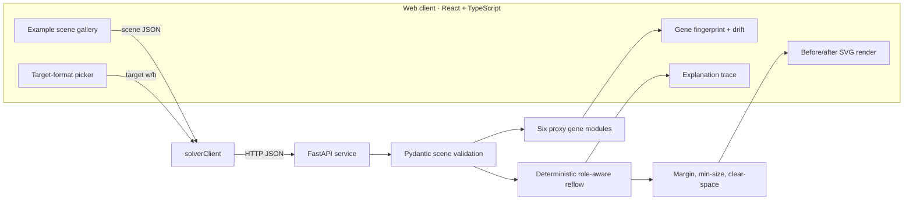

# Architecture

LayoutDNA is a standalone two-part project: a browser web client and a Python solver
service, joined by one versioned scene contract. Nothing depends on a host application.

## Web client

A self-contained React + TypeScript app (`add-on/`). It ships a gallery of example scenes
(`examples/*.json`), lets the viewer choose a target canvas format, sends the scene to the
solver, and renders the result entirely in the browser as an SVG before/after of the
re-layout — alongside the six-gene fingerprint, per-gene drift, and the solver's explanation
trace. There is no document host: the scene source is local JSON, and the same CLI
(`layoutdna`) drives the solver from a terminal with no browser at all.

If the solver is unreachable, the client shows a clear offline state rather than inventing a
result; it never fabricates boxes or scores.

## Solver service

A FastAPI service (`solver/`) exposing two endpoints:

- `POST /api/v1/fingerprint` — six deterministic geometric gene proxies for a scene.
- `POST /api/v1/optimize` — reflow a scene into a target canvas, returning target-normalized
  boxes, per-gene drift, and a grounded explanation trace.

Pydantic rejects incompatible or malformed scenes before any computation. The reflow is
deterministic and role-aware; drift is a geometric proxy, never a perceptual quality claim.

## Data path

1. The client loads a scene from the local example gallery (schema `1.0.0`).
2. It sends the scene to `/fingerprint` and `/optimize` with the chosen target dimensions.
3. Pydantic validates the scene; malformed input is rejected with a clear error.
4. The solver returns target-normalized boxes, drift metrics, and recorded explanation steps.
5. The client renders the source and solved layouts side by side as SVG and lists the trace.

The API shape is designed to survive replacement of the deterministic internals by a future
differentiable optimizer without changing the contract the client depends on.

## Scene contract

One scene schema is kept in sync across three surfaces: `schemas/scene.schema.json`
(JSON Schema), `add-on/src/types/scene.ts` (TypeScript), and `solver/schemas.py` (Pydantic).
`schemaVersion` is bumped deliberately when compatibility changes.
